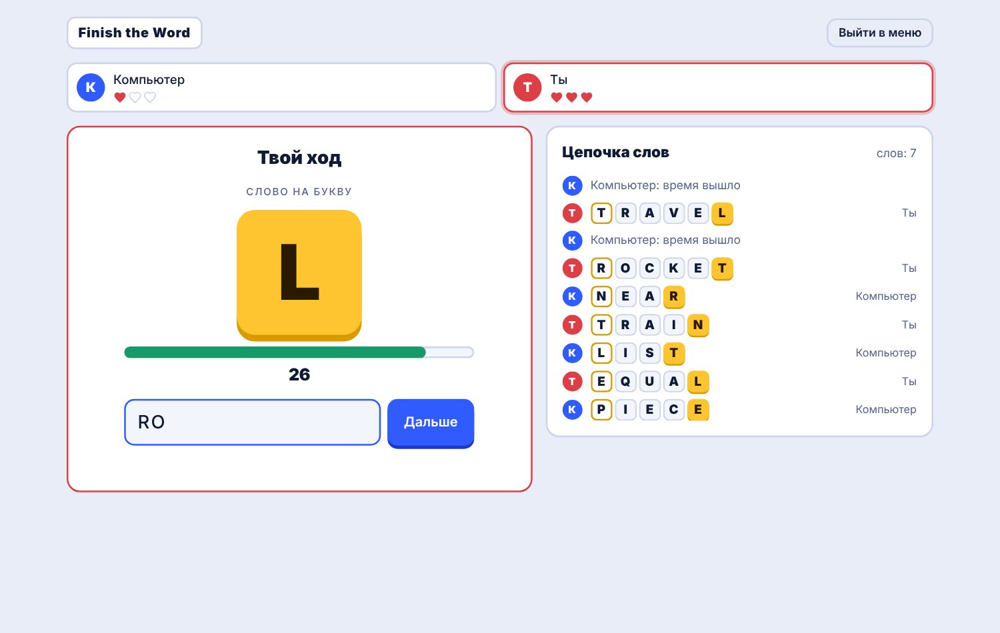

# Finish the Word



Цепочка английских слов на время: каждое следующее слово начинается на последнюю букву предыдущего. Не успел — теряешь жизнь. Последний, у кого остались жизни, побеждает.

**Играть:** https://muzara.github.io/finish-the-word/

## Режимы

- **Против компьютера.** Три уровня сложности. На сложном компьютер отвечает быстрее и нарочно выбирает слова, которые кончаются на неудобные буквы: X, Y, W.
- **От двух до четырёх игроков на одном устройстве.**
- Время на ход: 10, 15, 20 или 30 секунд. Жизней: 1, 2, 3 или 5.

Слова проверяются по словарю на 112 тысяч английских слов (`words-en.txt`). Повторять слова нельзя, минимум три буквы.

## Языки

Слова в игре всегда английские. Меню, правила и сообщения есть на русском, кыргызском и английском. Язык переключается в правом нижнем углу или ссылкой `?lang=ru`, `?lang=ky`, `?lang=en`.

## Запуск

Словарь загружается отдельным файлом, поэтому игре нужен веб-сервер:

- включите GitHub Pages: **Settings → Pages → Deploy from a branch → main / (root)**;
- или запустите локально: `python3 -m http.server` в папке репозитория и откройте http://localhost:8000.

Если открыть `index.html` двойным щелчком, игра запустится, но слова не будут сверяться со словарём.

## Файлы

```
index.html     страница игры
wordchain.js   логика игры, компьютер-соперник, тексты на трёх языках
words-en.txt   словарь
games.css      оформление
```

---

**English.** A timed English word chain: each word must start with the last letter of the previous one. Play the computer on three difficulty levels or up to four friends on one device. The interface is available in Russian, Kyrgyz and English.

Автор: Музар Алияскаров, студия «Клетка».
